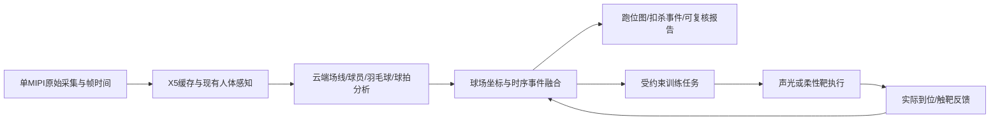

# 羽境 CourtSense

**基于球场线约束建图的人—球—拍协同分析与具身训练系统。**

让真实羽毛球场成为能理解训练过程的空间：先把球场与球员定位对齐，再关联击球、羽毛球轨迹与技术动作，最终以可验证的反馈支持训练。

> **P0.0.1 · 几何示意与开发基础，2026-11-05。** 已提供可运行的球场示意生成器、基础检查与协作规范。真实相机标定、球员定位、球迹和扣杀分析尚未实现。


图为本仓库程序生成的名义球场示意，不含真实训练数据。线条边缘/中心定义尚未进入标定级模型，不能将图中名义位置直接作为厘米级控制点。

**快速入口：** [报名答案](docs/registration.md) · [可运行示例](#本地开发) · [技术路线](docs/technical-plan.md) · [参与开发](CONTRIBUTING.md)

## 已有基础与新项目范围

前序RDK X5项目已完成单MIPI人体姿态服务、COCO17与骨架显示、二维关节角和状态工作台、标准球场展示、VS Code远程开发及Git版本管理，最近一次短时姿态验证约13 FPS。此前小规模模型微调量化已跑通，但尚不能可靠实时评分。

以上是前序项目的实测基础，并非本仓库已经集成的功能；原代码、模型和原始视频未复制到本仓库。13 FPS为姿态处理记录，不能当作相机采集帧率或高速羽毛球检测能力。

| 新项目能力 | 当前状态 | 验证方式 |
| --- | --- | --- |
| 名义球场模板与SVG/JSON导出 | 已实现基础示例 | 几何范围/对称、SVG解析和CLI防覆盖检查 |
| 球场线约束标定、机位漂移检查 | 待开发 | 独立地面控制点与线条重投影 |
| 球员跑位点位图、时间加权热图 | 待开发 | 实测站位、遮挡/跳起与身份切换专项 |
| 击球和扣杀计数 | 待开发 | 人工逐事件标注、类别混淆与计数误差 |
| 羽毛球二维轨迹 | 待开发 | 可见帧标注、漏检、误检与轨迹中断 |
| 单目受约束三维轨迹及球速 | 研究项 | 独立参考测量、可辨识性与误差范围 |
| 球拍—手腕动作分析 | 后续研究 | 球拍/手部专门标注及教练评价 |
| 声光或柔性靶具身反馈 | 后续扩展 | 执行到位、实际反馈和训练结果验证 |

## 设计重点

- **球场就是先验地图。** 利用既有球场线、交点和尺寸进行拓扑匹配及相机标定。固定机位采用已知地图定位与重投影校验，不为建图而强行使用通用SLAM。
- **地面位置与空中球轨分开。** 平面映射服务于可信的地面接触点，不能直接把空中羽毛球换算成米制位置或球速。
- **端侧采集、云端重计算。** X5优先保证原始时间戳、采集、缓存与现有感知；新球体/球拍模型、轨迹重建和报告优先放云端。暂无新增板端大模型部署计划。
- **结果可追溯。** 每个事件关联视频片段、帧时间、球员身份、标定和模型版本；区分检测、插值、模型估计与人工确认。
- **具身闭环按条件扩展。** 经验证的空间状态用于选择训练任务，执行器实际反馈决定后续行为。当前仓库还不具备实体执行能力。

## 文档入口

- [报名填写稿](docs/registration.md)：可复制的表单答案与已有/拟做区分。
- [技术方案](docs/technical-plan.md)：建图、定位、球轨、球速、扣杀与评分的难点和边界。
- [阶段路线与验收](docs/roadmap.md)：按依赖推进，不同时承诺全部指标。
- [开发交接](docs/handoff.md)：后续继续开发的入口及待确认事项。
- [资料与复用边界](docs/sources.md)：一手参考与第三方资源检查要求。
- [数据契约草案](docs/data-contract.md)：坐标、时钟、事件去重与结果来源。
- [采样与评价规范](docs/annotation-and-evaluation.md)：真实素材标注、独立参考与验收方法。

## 数据流（拟实现）



图中为目标架构，不是当前运行状态。云端结果分别显示事件发生时间和分析完成时间，延迟到达的数据不能驱动过期动作。

## 本地开发

Python 3.10+，仅使用标准库，无需GPU、相机、云账号或下载模型。在仓库根目录运行：

```text
python -m courtsense --output artifacts/first-court-preview
python -m unittest discover -s tests -v
```

Windows也可使用`py -3`。第一条命令生成`court.svg`和带语义线段的`court.json`；用浏览器打开SVG即可查看。输出路径必须是新目录，已有结果不会覆盖。

JSON明确包含`evidence_type: nominal_geometry`和`usable_for_metric_calibration: false`。这个工具不读取视频、不定位球员、不生成球速。下一步是相机采样审计和真实标定小样；原设备服务的维护和部署需独立授权、备份与验证。

## 仓库结构

```text
courtsense/     可运行的名义球场示例与命令入口
tests/          几何与输出行为检查
docs/           报名、技术方案、数据与验收约定、开发交接
.github/        问题模板与PR模板
```

当前没有Web应用、云端API或板端采集适配。贡献和功能建议可使用仓库Issue模板；后续任务按[阶段路线](docs/roadmap.md)推进。

自动测试配置保留为[CI模板](docs/ci/README.md)。当前GitHub授权不允许创建workflow，远程CI尚未启用；本地检查通过不能替代未来的远程运行结果。

公开视频、训练数据和模型权重分别核对许可后使用。本仓库未捆绑第三方模型或代码。私人训练素材、凭据、设备地址及原项目历史不公开上传。

## 迭代记录

| 版本 | 日期 | 改动 | 验证与限制 |
| --- | --- | --- | --- |
| P0.0 | 2026-11-05 | 独立建档，整理报名答案、技术路线、验收与开发交接 | 文档阶段；未部署新功能、无新性能或精度结论 |
| P0.0.1 | 2026-11-05 | 新增名义球场SVG/JSON示例、数据/标注评价规范、协作模板及CI待启用模板 | 本地3项基础测试通过；真实分析和米制标定仍待开发，远程CI未启用 |
