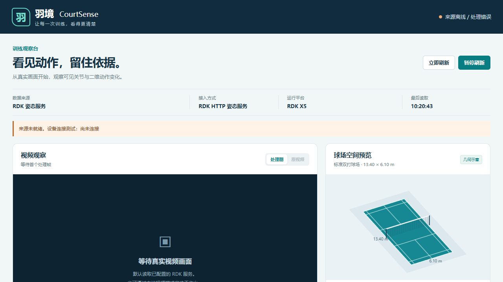
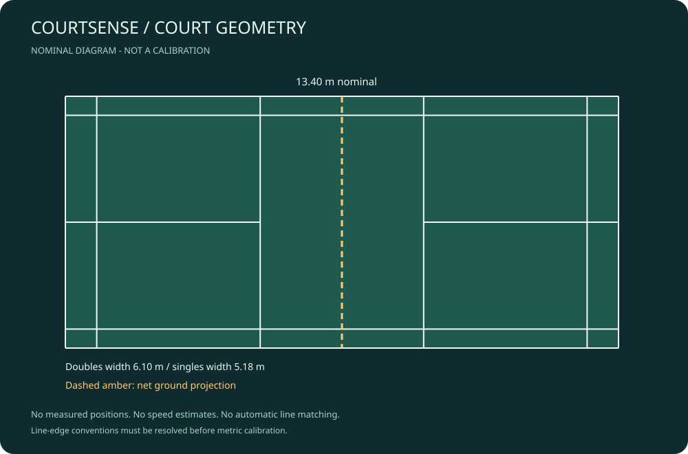
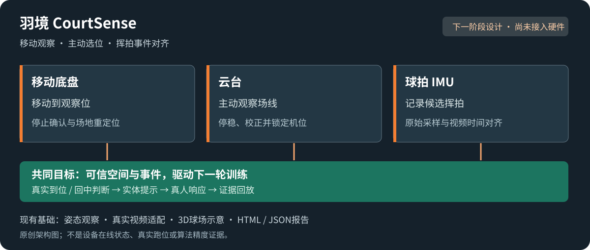
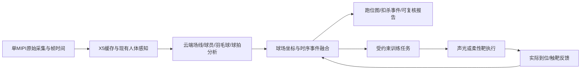

# 羽境 CourtSense

**基于球场线约束建图的人—球—拍协同分析与具身训练系统。**

下一阶段聚焦三项关键扩展：**移动底盘、云台、球拍 IMU**。让设备停靠并找准观察位置，将候选挥拍与视频对齐，再根据真实到位和回中情况推进训练。

让真实羽毛球场成为能理解训练过程的空间：先把球场与球员定位对齐，再关联击球、羽毛球轨迹与技术动作，最终以可验证的反馈支持训练。

> **P0.1.1 · 三设备扩展设计与任务拆分，2026-11-06。** 本次为文档更新，运行程序沿用P0.1.0；底盘、云台、IMU与实体控制均未接入。
>
> **P0.1.0 · 姿态代码与视频工作台，2026-11-05。** 默认连接RDK已有姿态服务；新增真实视频姿态适配、3D球场预览与HTML/JSON观察报告。公开视频已在电脑CPU验证，整合后的工作台尚未在真实RDK验收；自动标定、米制跑位、球迹与扣杀仍待开发。



上图为界面空态测试，展示视频区与可旋转3D球场。公开视频实际推理记录见[真实适配验证](docs/validation-video-2026-11-05.md)；受版权及数据再分发限制，不随仓库提供比赛画面。



图为本仓库程序生成的名义球场示意，不含真实训练数据。线条边缘/中心定义尚未进入标定级模型，不能将图中名义位置直接作为厘米级控制点。

**快速入口：** [RDK与视频启动](docs/running-workbench.md) · [真实视频验证](docs/validation-video-2026-11-05.md) · [迁移与来源](docs/migration.md) · [报名答案](docs/registration.md) · [技术路线](docs/technical-plan.md)

## 下一阶段：移动底盘、云台、球拍 IMU



| 关键扩展 | 要做出的实际能力 | 完成条件 |
| --- | --- | --- |
| 移动底盘 | 训练前移动停靠，停车后用场线确认观察位置 | 停止反馈、重定位实验；训练时禁止移动 |
| 云台 | 主动观察场线、复现机位、停稳锁定后采集 | 角度回读与视觉校正；机位变化使旧标定失效 |
| 球拍 IMU | 原始采样、时钟对齐、候选挥拍与视频关联 | 对齐误差、空挥误触发、漏检与事件去重记录 |

三项都是关键扩展，按依赖逐步接通。最小闭环从三个训练区开始：实体提示目标，视觉确认到位与回中，IMU可用时附加挥拍条件，再决定下一轮任务。首先跑通固定支架模式，随后扩展移动停靠与主动观察。

[三设备技术设计](docs/embodied-expansion.md) · [开发任务与验收](docs/extension-tasks.md) · [工作台重设计](docs/workbench-design.md)

底盘可进一步扩展训练后捡球，但球体定位、导航与回收机构需要单独开发；云台扫描不等于测得动态球体深度；IMU峰值不等于真实触球或扣杀。机械臂和灵巧手保留为平台选项。

## 已有基础与新项目范围

前序RDK X5项目已完成单MIPI人体姿态服务、COCO17与骨架显示、二维关节角和状态工作台、标准球场展示、VS Code远程开发及Git版本管理，最近一次短时姿态验证约13 FPS。此前小规模模型微调量化已跑通，但尚不能可靠实时评分。

以上是前序项目的实测基础。经用户授权，COCO17观察、骨架连线、固定安装方向辅助三个基础源码已迁入`courtsense/pose/`，源提交与SHA256见[迁移说明](docs/migration.md)。原相机服务、模型、原始视频及私人材料未复制。13 FPS是前序服务历史记录，不是本版性能。

| 新项目能力 | 当前状态 | 验证方式 |
| --- | --- | --- |
| 姿态基础代码与只读RDK来源 | 已实现，RDK整体验收待完成 | 原文件溯源、概率/角度边界、HTTP配对夹具 |
| 视频姿态、二维角与观察报告 | 已实现适配起点 | 真实比赛20秒片段、100抽样帧，见验证记录 |
| 交互3D球场预览 | 已实现几何视图 | 拖拽/键盘旋转；不是三维重建或米制定位 |
| 名义球场模板与SVG/JSON导出 | 已实现基础示例 | 几何范围/对称、SVG解析和CLI防覆盖检查 |
| 移动底盘、云台、球拍 IMU | 已形成设计与任务，硬件未接入 | 见三设备设计与独立验收 |
| 球场线约束标定、机位漂移检查 | 待开发 | 独立地面控制点与线条重投影 |
| 球员跑位点位图、时间加权热图 | 待开发 | 实测站位、遮挡/跳起与身份切换专项 |
| 击球和扣杀计数 | 待开发 | 人工逐事件标注、类别混淆与计数误差 |
| 羽毛球二维轨迹 | 待开发 | 可见帧标注、漏检、误检与轨迹中断 |
| 单目受约束三维轨迹及球速 | 研究项 | 独立参考测量、可辨识性与误差范围 |
| 球拍—手腕动作分析 | 后续研究 | 球拍/手部专门标注及教练评价 |
| 声光或柔性靶具身反馈 | 后续扩展 | 执行到位、实际反馈和训练结果验证 |

## 设计重点

- **球场就是先验地图。** 利用既有球场线、交点和尺寸进行拓扑匹配及相机标定。固定机位采用已知地图定位与重投影校验，不为建图而强行使用通用SLAM。
- **地面位置与空中球轨分开。** 平面映射服务于可信的地面接触点，不能直接把空中羽毛球换算成米制位置或球速。
- **端侧采集、云端重计算。** X5优先保证原始时间戳、采集、缓存与现有感知；新球体/球拍模型、轨迹重建和报告优先放云端。暂无新增板端大模型部署计划。
- **结果可追溯。** 每个事件关联视频片段、帧时间、球员身份、标定和模型版本；区分检测、插值、模型估计与人工确认。
- **具身闭环按条件扩展。** 经验证的空间状态用于选择训练任务，执行器实际反馈决定后续行为。当前仓库还不具备实体执行能力。

## 文档入口

- [报名填写稿](docs/registration.md)：可复制的表单答案与已有/拟做区分。
- [技术方案](docs/technical-plan.md)：建图、定位、球轨、球速、扣杀与评分的难点和边界。
- [阶段路线与验收](docs/roadmap.md)：按依赖推进，不同时承诺全部指标。
- [开发交接](docs/handoff.md)：后续继续开发的入口及待确认事项。
- [资料与复用边界](docs/sources.md)：一手参考与第三方资源检查要求。
- [数据契约草案](docs/data-contract.md)：坐标、时钟、事件去重与结果来源。
- [采样与评价规范](docs/annotation-and-evaluation.md)：真实素材标注、独立参考与验收方法。

## 数据流（拟实现）



图中为目标架构，不是当前运行状态。云端结果分别显示事件发生时间和分析完成时间，延迟到达的数据不能驱动过期动作。

## 本地开发

### 默认：RDK X5同机读取已有姿态服务

Python 3.10+，只读模式使用标准库，不新增端侧模型，不另开MIPI。原服务须已有`/observations`和`/frame.jpg`配对接口。在板卡项目目录运行：

```text
python3 -m courtsense monitor
```

也可直接`python3 -m courtsense`。通过VS Code转发8793端口，打开`http://127.0.0.1:8793/`。默认上游为同机8080；若没有兼容原服务会明确离线，不会自动显示演示数据。此为默认目标方式，**不代表本版已在RDK测试通过**。

### 可选：电脑/云主机适配授权视频

独立环境安装依赖，显式准备COCO17模型和本地授权素材：

```text
python -m pip install -r requirements-video.txt
python -m courtsense monitor --source video --video /path/to/authorized.mp4 --model /path/to/yolo11n-pose.pt --stride 5 --max-frames 100 --device cpu
```

`max-frames`是推理样本数，stride为源帧抽样步长。模型不会自动下载，依赖与模型有独立许可；原视频播放和处理帧更新不声称同步。完整说明见[运行指南](docs/running-workbench.md)。

### 几何示例与基础测试

以下命令不需要视频依赖、GPU、相机、云账号或模型：

```text
python -m courtsense --output artifacts/first-court-preview
python -m unittest discover -s tests -v
```

Windows也可使用`py -3`。第一条命令生成`court.svg`和带语义线段的`court.json`；用浏览器打开SVG即可查看。输出路径必须是新目录，已有结果不会覆盖。

JSON明确包含`evidence_type: nominal_geometry`和`usable_for_metric_calibration: false`。这个工具不读取视频、不定位球员、不生成球速。下一步是相机采样审计和真实标定小样；原设备服务的维护和部署需独立授权、备份与验证。

## 仓库结构

```text
courtsense/pose/    迁入的姿态观察、骨架与方向基础
courtsense/sources/ RDK只读配对适配
courtsense/web/     视频、关节点、3D预览及报告界面
courtsense/video.py 可选视频推理适配
courtsense/report.py 有界统计与报告导出
tests/          几何、配对、视频异常与统计检查
docs/           报名、技术方案、数据与验收约定、开发交接
.github/        问题模板与PR模板
```

当前已有本地HTTP工作台和已有RDK服务读取适配，没有新的BPU推理引擎、自动云端部署或公网服务。后续任务按[阶段路线](docs/roadmap.md)推进，原始素材和权重不进入公开仓库。

自动测试配置保留为[CI模板](docs/ci/README.md)。当前GitHub授权不允许创建workflow，远程CI尚未启用；本地检查通过不能替代未来的远程运行结果。

公开视频、训练数据和模型权重分别核对许可后使用。已迁入的用户姿态基础及可选依赖许可见[来源与第三方说明](THIRD_PARTY_NOTICES.md)；不捆绑模型权重或官方BPU推理实现。私人素材、凭据、设备地址及原项目历史不公开上传。

## 迭代记录

每次有意义的改动提交Git并记录验证；版本行中的设计完成不代表硬件运行完成。

| 版本 | 日期 | 改动 | 验证与限制 |
| --- | --- | --- | --- |
| P0.0 | 2026-11-05 | 独立建档，整理报名答案、技术路线、验收与开发交接 | 文档阶段；未部署新功能、无新性能或精度结论 |
| P0.0.1 | 2026-11-05 | 新增名义球场SVG/JSON示例、数据/标注评价规范、协作模板及CI待启用模板 | 本地3项基础测试通过；真实分析和米制标定仍待开发，远程CI未启用 |
| P0.1.0 | 2026-11-05 | 迁入姿态基础，新增默认RDK读取、视频适配、3D工作台与报告 | 28项本地测试与JS语法检查通过；真实比赛100抽样帧CPU跑通，整合版尚未真实RDK验收；非动作精度结论 |
| P0.1.1 | 2026-11-06 | 将移动底盘、云台、球拍IMU列为关键扩展；新增架构图、设备流程、任务验收及UI设计；更新报名与交接 | 文档更新，运行程序沿用P0.1.0；三项硬件、实体反馈和新UI均未接入 |
