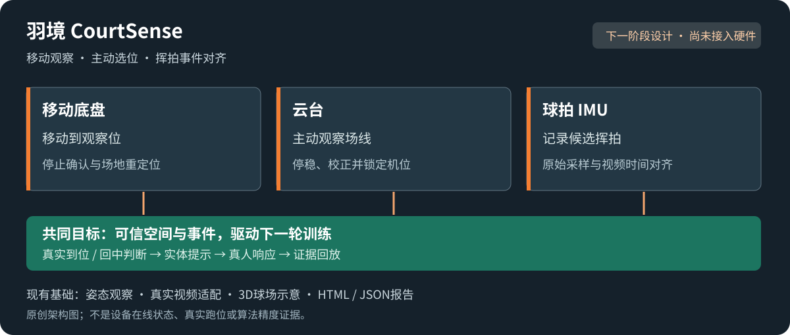
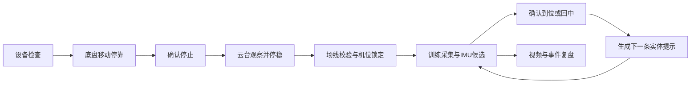

# 三项关键扩展：移动底盘、云台与球拍 IMU

2026-11-06 · 设计基线。三项均为下一阶段关键扩展，目前没有接入本仓库。现有运行能力和历史实测以 README 为准。

目标是让 CourtSense 从观察工作台发展为能部署观察位置、关联挥拍事件、根据真实完成情况调整任务的具身训练系统。保留单相机低成本基线，重计算新模型优先云端；训练是否继续、暂停与执行器停止由端侧判断，云端迟到结果不驱动过期动作。

## 三项设备各自解决什么

| 模块 | 第一项实际任务 | 与现有项目的连接 | 后续能力 |
| --- | --- | --- | --- |
| 移动底盘 | 训练前移动到观察位，停靠后重新确认场地坐标 | 球场地图、相机安装位置、采集会话 | 场地巡查；训练结束后静态球定位与回收 |
| 云台 | 主动选择观察方向，停稳后扫线、复现机位并锁定 | 场线可见性、标定版本、姿态服务 | 质量不足时补采；局部关键动作观察 |
| 球拍 IMU | 带采样时间的候选挥拍窗口 | 视频时间线、骨架、候选击球和回放 | 动作阶段辅助、空挥区分与融合分类 |

底盘是移动观察平台，云台是主动观察机构，IMU是事件来源。三项共同进入主路线；实现顺序按依赖逐步接通，不要求第一轮同时完成全部扩展。

## 空间与时间链路

空间链路为球场 → 底盘 → 云台 → 相机，分别保存变换、时间、来源和标定版本。底盘里程计仅提供先验，停车后仍需场线或独立参考校正；轮滑、结构回差和相机安装变化都可能影响结果。

云台转动通常改变图像到球场的映射。不能只靠角度回读复用旧单应矩阵，也不能把绕光心转动当成测深基线。初期固定焦距，采用“运动 → 停稳 → 场线校验 → 锁定 → 采集”。自动匹配失败可人工确认交点，保存来源；未通过验证就保持像素观察模式。

球拍 IMU 保存原始采样时间、序号、轴定义、单位、量程和安装朝向。时钟对齐需估计偏移和漂移，并记录对齐残差与适用区间；Linux 收包时间不能替代 IMU 采样或相机曝光时间。没有曝光时间戳时如实记录时间戳来源。同步误差和事件定位误差分别测量，不预先承诺毫秒级。

IMU峰值只能产生候选挥拍。空挥、碰撞、抖动都是负样本；真实触球和扣杀标签需要视频或其他独立参考。IMU本身不提供球场绝对位置、羽毛球轨迹或真实球速。

## 共用状态流程

以上为拟实现流程，不是当前控制程序。训练期间底盘保持停止，云台锁定；重定位、机位改变、画面过期或人员丢失时暂停空间判断与下一条任务。固定支架模式可跳过底盘移动；手动机位模式可跳过自动云台动作，仍须场线校验。

所有设备命令携带命令ID、会话ID、发出时间、截止时间及预期状态；反馈区分已接收、执行中、实际到位、拒绝、故障和停止。确认收包不代表执行到位，重复命令不重复触发动作。底层停止与限位通过实际控制器验收。

## 最小实体训练闭环

先做中点、左前、右前三个明确训练区。实体目标灯给出目标，视觉确认到位；IMU可用时附加候选挥拍条件；系统提示回中，确认回位稳定后才发下一题。尚无可靠场地标定时只使用人工配置的图像区域，不输出米制距离。

第一版反馈包括区域完成次数、有效观察覆盖率、回中用时、缺失区间及可回放事件。节奏调整依据最近有效轮次的表现，保留规则和版本。没有教练参考与专项验证时不生成专业动作总分，也不把挥拍数直接标为扣杀数。

训练区状态和实体灯光反馈属于新增实现任务，当前观察工作台没有这些控制能力。

## 独立验收与降级

| 模块 | 必须留下的证据 | 失败时行为 |
| --- | --- | --- |
| 底盘 | 重复停靠、停止反馈、重定位误差与成功率；训练中移动拒绝记录 | 固定支架；定位失效时暂停米制输出 |
| 云台 | 预设位回读、停稳时间、重复机位的视觉残差；补采与失败记录 | 手动固定机位并重新确认场线 |
| IMU | 原始样本、时钟拟合与残差、标注事件、空挥误触发和漏检 | 人工标记事件；取消依赖精确对齐的评价 |
| 联合闭环 | 连续十轮；未回中不推进；遮挡等待；断连停止；视频与任务可互查 | 保留观察和复盘，明确未完成的实体能力 |

移动底盘的自动捡球需要额外的球体定位、导航、接近和回收机构实验，列为后续任务。机械臂、机械狗和灵巧手可作为替代硬件研究，不作为上述三项主线的完成前提。

## 候选研究与比较

主动观察对比固定预设位，报告独立控制点误差、标定成功率与部署时间；视觉事件对比视觉＋IMU，报告事件精确率、召回率、重复计数与时间误差；定时推进对比状态推进，报告错误推进、等待时长和任务完成情况。实验按球场、机位和人员隔离，避免把相邻帧当独立样本。

上述是待验证问题。灯光引导步法已有先例；论文或专利贡献需进一步检索，并依赖真实对照实验。

参考：[OpenCV标定](https://docs.opencv.org/4.x/d9/d0c/group__calib3d.html)、[相机触发机制](https://docs.baslerweb.com/triggered-image-acquisition)、[已有羽毛球视觉反应训练研究](https://www.mdpi.com/1424-8220/20/23/6808)。这些资料不是已集成依赖。
