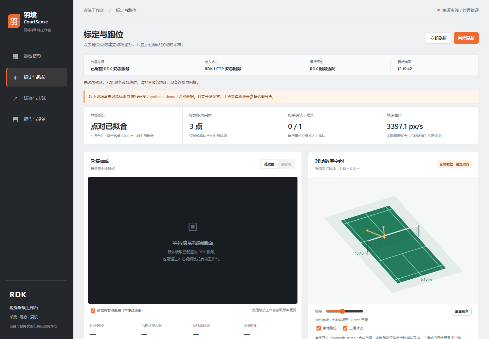

# P0.2.0 开发验证记录

日期：2026-11-06。平台：本机Windows、Python标准库HTTP服务、浏览器。没有连接或修改真实RDK服务，没有新增模型或云服务部署。

## 验证结果

- 根代理重新运行Python单元测试39项，全部通过；较P0.1.0新增11项分析测试。
- JavaScript语法检查及git diff --check通过。
- 浏览器检查四工作区导航、主动合成预览、JSON导入、输入/结果导出、坏JSON不覆盖原结果、清除恢复空态。
- 检查球场方向键旋转、Home重置、跑位与球迹图层；390px窄屏无横向溢出。浏览器页面与控制台错误为0。

## 数值与错误边界

合成点对验证透视映射和超定拟合；共线、重复、非有限值和像素越界被拒绝。只有接地确认点生成米制位置。球迹缺失、时间不递增、三维来源变化、冲突event_id和持久化失败有专项测试。HTTP检查JSON限制、同源写入、原子替换、来源变化失效和独立存储。

页面快捷合成样例有3个接地采样点、0条确认/1条候选扣杀事件及像素速度。它们完全由人工构造，不证明识别准确率、球场位置精度或真实球速。

## 适用限制

目前需要手动点对或导入上游结果，没有自动场线提取、真实接地识别、羽毛球检测、扣杀分类、三维轨迹重建或真实测速。已有姿态服务仍是唯一MIPI所有者，新增分析API不访问摄像头。

真实采样后需分别评价独立控制点误差、位置有效覆盖率、球体漏检、事件精确率/召回率、时间误差与参考速度；本次合成测试不能替代这些实验。GitHub发布状态以实际同步结果为准，本记录不声明远程CI运行成功。
